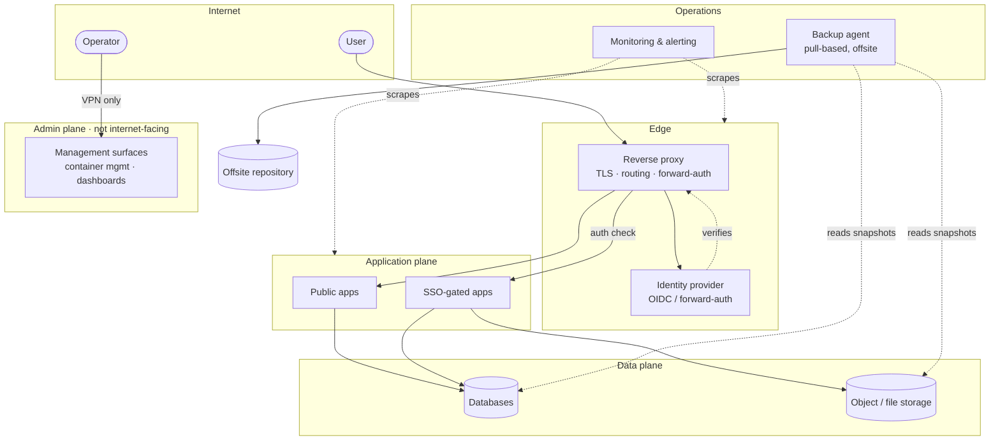

# Homelab Platform Blueprint

A reference architecture for running a small fleet of self-hosted services on a
single node — reverse proxy, single sign-on, a dozen or two containerised apps,
their databases, backups and monitoring — without it turning into a pile of
unmanaged containers.

This repository is **documentation only**. It describes a design and the
reasoning behind it; it is not a deployment of any particular system and contains
no hostnames, addresses, credentials or environment-specific configuration. Tool
names (Caddy, Authentik, Restic, …) appear as concrete examples of a category,
not as requirements — the shape of the architecture is what matters.

## Why this exists

Self-hosting tends to grow one `docker run` at a time. Six months in there is no
single source of truth, no consistent way in, secrets live in shell history, and
nobody is sure the backups restore. This blueprint is the opposite: one
git-managed definition of the whole platform, one authenticated entry point, one
backup story, and a short list of rules that every new service follows.

## The design in one diagram

## Contents

| Doc | Topic |
| --- | --- |
| [`docs/01-overview.md`](docs/01-overview.md) | Goals, non-goals, the platform rules |
| [`docs/02-architecture.md`](docs/02-architecture.md) | C4 context and container views |
| [`docs/03-networking-and-access.md`](docs/03-networking-and-access.md) | Ingress, segmentation, admin isolation |
| [`docs/04-identity-and-authz.md`](docs/04-identity-and-authz.md) | SSO, forward-auth, authorisation model |
| [`docs/05-delivery.md`](docs/05-delivery.md) | GitOps deploy loop and CI |
| [`docs/06-data-and-backup.md`](docs/06-data-and-backup.md) | Persistence, backup, restore testing |
| [`docs/07-observability.md`](docs/07-observability.md) | Metrics, logs, alerting, uptime |
| [`docs/decisions/`](docs/decisions) | Architecture decision records |
| [`docs/glossary.md`](docs/glossary.md) | Terms |

## Status

Living document. Decisions are recorded as ADRs; superseded ones are kept and
marked, not deleted.
