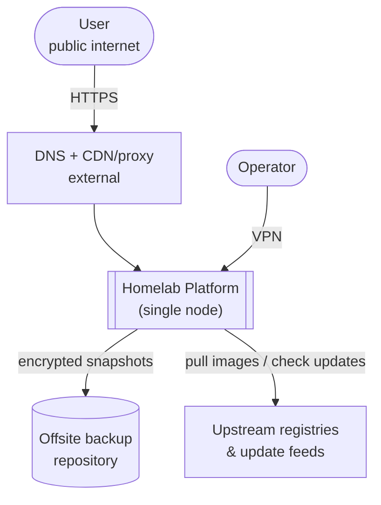
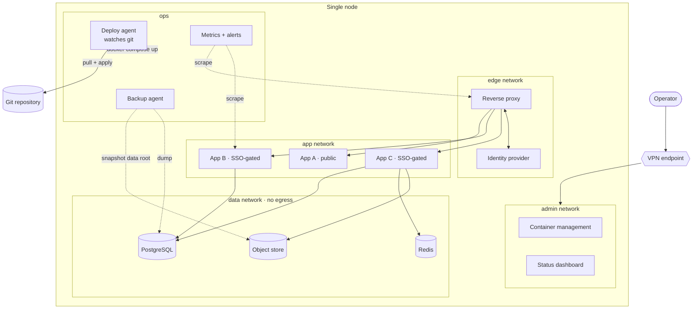
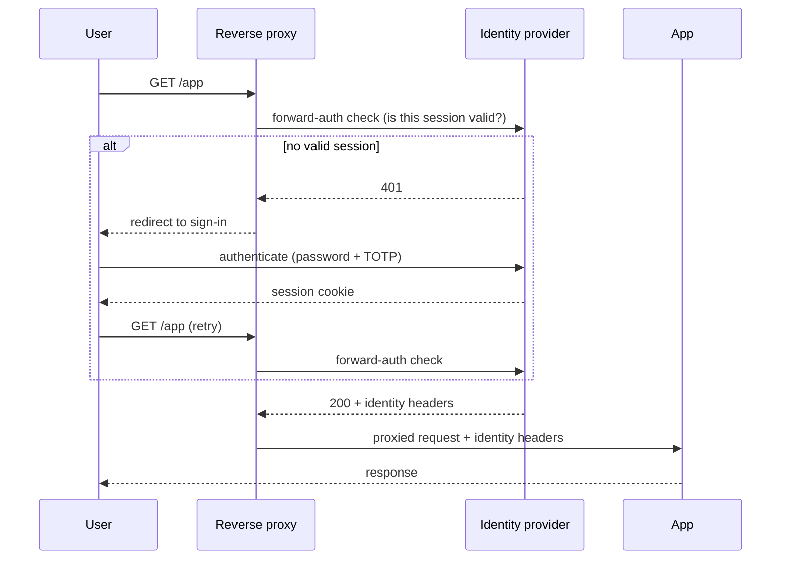

# 2 · Architecture

The views below follow the [C4 model](https://c4model.com/): context first, then
one level down into containers. Deployment specifics (addresses, counts, sizing)
are intentionally absent — this is the shape, not an inventory.

## Context

The platform trusts: the operator over VPN, and the git repository. It does not
trust: the public internet, an authenticated user's device, or an image tag it
has not pinned.

## Containers

### Planes

- **Edge plane** — the reverse proxy and the identity provider. The only
  containers that receive traffic that originated outside the node.
- **Application plane** — the services themselves, split by whether they are
  public or require SSO. Apps never talk to each other directly; if they need
  to, they go through the edge or a defined API.
- **Data plane** — databases and storage, on a network with **no outbound
  route**. Reachable only from the specific apps that own the data.
- **Admin plane** — management UIs. On their own network, never routed by the
  public edge, reachable only over VPN. See ADR&nbsp;0003.
- **Ops plane** — the deploy agent, backup agent, and monitoring. On-node
  automation with narrowly scoped permissions.

## Request path for a gated app

The app receives the request only after the proxy has confirmed a valid session.
The app reads the identity from trusted headers set by the proxy; it never sees
credentials and has no login page of its own.
