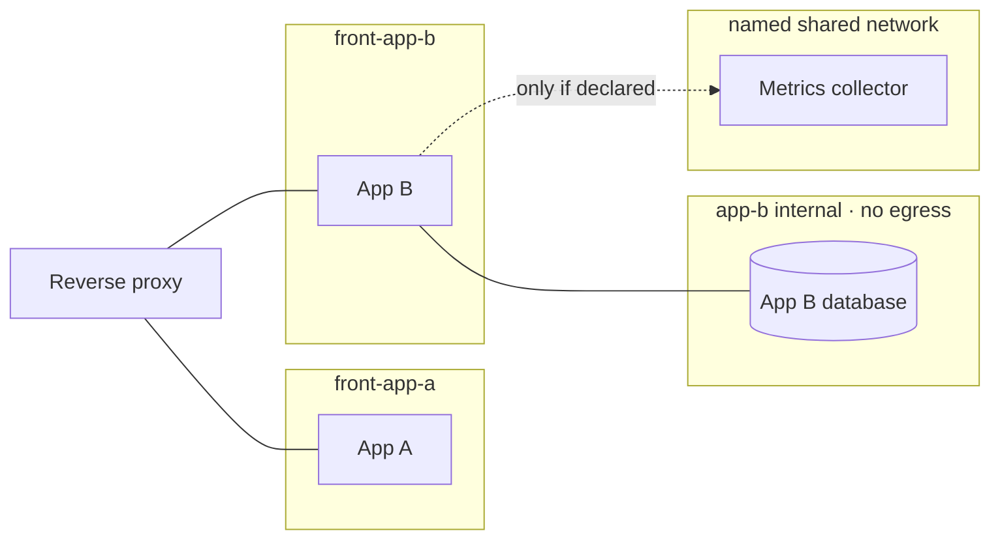
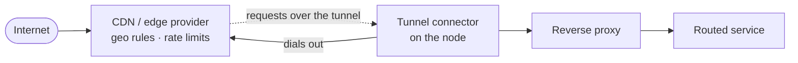
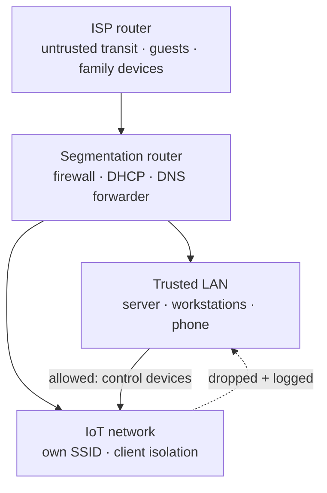
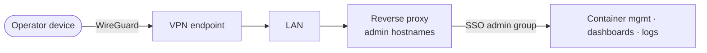
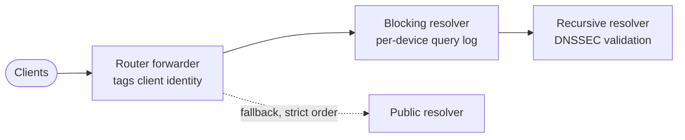

# 3 · Networking and Access

## Principle

Reachability is a design decision, made once per service, and expressed as
network membership — not as a firewall rule bolted on afterwards. A service is
exactly as reachable as the networks it joins.

## Networks on the node

Every app gets **its own front network, shared only with the reverse proxy**.
Two apps never sit on the same network unless a real dependency between them
is written down as a named shared network.

| Network | Members | Egress | Reachable from outside the node |
| --- | --- | --- | --- |
| `front-<app>` | the reverse proxy + one app | yes (updates, webhooks) | no — only via the proxy |
| `<app>` internal | one app + its own database/cache | **no** | no |
| named shared (`mon`, `llm`, …) | the few services with a declared cross-app link | as needed | no |
| admin | management UIs | yes | no — LAN/VPN + SSO only |

A compromised app can reach the proxy and its own database. It cannot reach
another app, another app's database, or the container-management UI.

The Docker API is never mounted into an app. Services that need to *read*
container state go through a read-only socket proxy. Ports that Docker
publishes on the host are additionally scoped by host firewall rules, because
Docker's own port publishing bypasses the normal host firewall.

## Ingress: outbound only

The node accepts **no inbound HTTP(S) from the internet**. Public web traffic
arrives through an **outbound tunnel**: a connector on the node dials out to the
CDN/proxy provider, and public hostnames are served over that connection.
See ADR&nbsp;0006.

- **Only a short, explicit list of hostnames** is published through the tunnel —
  the identity provider, the git forge, and the few apps that are meant to be
  public. Everything else exists only on the LAN and the VPN.
- **Port forwards are limited to non-HTTP protocols that need them:** the VPN
  endpoint and game servers. 80/443 are not forwarded.
- TLS terminates at the reverse proxy, with certificates from ACME via a DNS
  challenge, so issuance needs no inbound port and wildcards are possible.
- The reverse proxy is still the only place routing is defined. The tunnel is
  transport, not a second router.
- **Trade-off, accepted:** the edge provider terminates TLS for tunnel
  hostnames, so it sees that traffic in plaintext. In return the node has no
  open web port to scan, and the provider absorbs floods.

## Two kinds of hostname

| | Browser hostnames | Machine hostnames |
| --- | --- | --- |
| Who | people | services, desktop/laptop agents |
| Proof | SSO session (passkey / password + TOTP) | **client certificate** (mTLS) |
| Exposure | LAN/VPN; a few also on the tunnel | **LAN/VPN only, never on the tunnel** |
| Proxy check | forward-auth or the app's OIDC | the certificate's exact identity, not just "signed by our CA" |

Browsers are never asked for a certificate, and machines never hold a
session cookie. Workload identity is covered in
[`08-secrets-and-workload-identity.md`](08-secrets-and-workload-identity.md).

## The home network around the node

The node is one segment of a segmented home network:

- **IoT devices** may reach the internet and the router's DHCP/DNS — nothing
  else. IoT-to-LAN traffic is dropped and logged, and new outbound
  destinations from IoT are logged. The home-automation hub on the LAN may
  reach into IoT to control devices; the reverse is never allowed.
- **The ISP router is treated as untrusted.** It is transit for the segmentation
  router and a separate network for guests.
- **The router feeds monitoring:** firewall drops and DHCP leases go to the
  central log store (new-device alerts come from there), and its health is
  polled like any other host.

## Operator access

The operator does **not** get a public admin URL. Administrative surfaces are
reached from the LAN or after connecting to the VPN, and still require an SSO
login with the admin account. Being on the network is necessary, not
sufficient.

Shell access to the node is key-only and limited to private source addresses.
Rationale for keeping admin surfaces off the public edge is in ADR&nbsp;0003.

## DNS

- Each hop does one job: the router forwarder attaches which client asked, the
  blocking resolver filters and logs per device, and the recursive resolver
  talks to the root servers directly and validates DNSSEC.
- A public fallback keeps the network resolving while the node reboots.
- A wildcard record points service subdomains at the node on the LAN. This is
  convenience, not a security boundary. The security boundary is network
  membership plus authentication.
