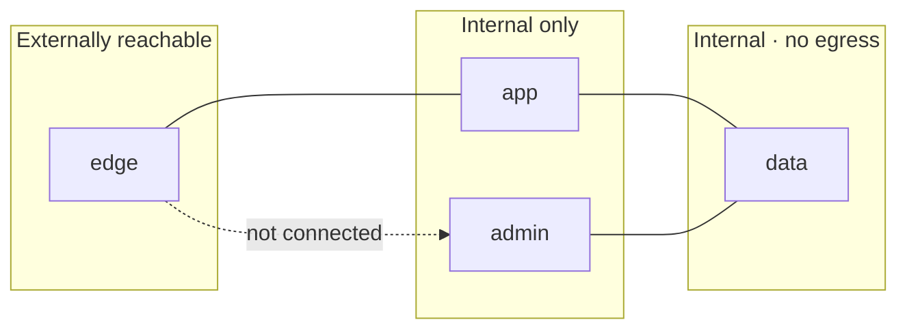
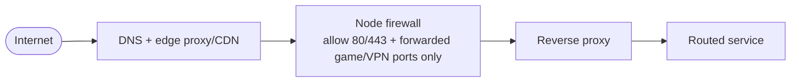
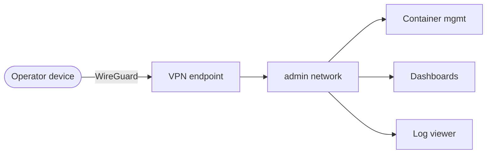

# 3 · Networking and Access

## Principle

Reachability is a design decision, made once per service, and expressed as
network membership — not as a firewall rule bolted on afterwards. A service is
exactly as reachable as the networks it joins.

## Networks

| Network | Members | Egress | Ingress from outside the node |
| --- | --- | --- | --- |
| `edge` | reverse proxy, identity provider | yes | yes — ports 80/443 |
| `app` | application containers | yes (updates, webhooks) | no |
| `admin` | management UIs | yes | no — VPN only |
| `data` | databases, object storage | **no** | no |

The `edge` network and the `admin` network are **never joined**. A compromise of
a public-facing app does not put the attacker on the same network as the
container-management UI.

## Ingress

- Exactly two classes of inbound port are open on the node: **HTTP(S)** to the
  reverse proxy, and a small explicit set of **forwarded ports** for workloads
  that genuinely need them (game servers, the VPN endpoint). Everything else is
  closed.
- TLS terminates at the reverse proxy. Certificates are obtained automatically
  via ACME using a DNS challenge, so no inbound port is needed for issuance and
  wildcard certificates are possible.
- The reverse proxy is the only place routing is defined. Adding a service means
  adding one route block, not touching DNS or the firewall.

## Operator access

The operator does **not** get a public admin URL. Administrative surfaces are
reached by first connecting to the VPN, which places the operator's device on the
internal networks. From there the admin UIs are ordinary internal services.

Rationale and the alternative that was rejected (gated public routes) are in
ADR&nbsp;0003.

## DNS

- A single wildcard record points all service subdomains at the edge.
- Internal resolution can be split-horizon so that on-network clients reach
  services directly, but this is an optimisation, not a security boundary — the
  security boundary is the network membership above.
