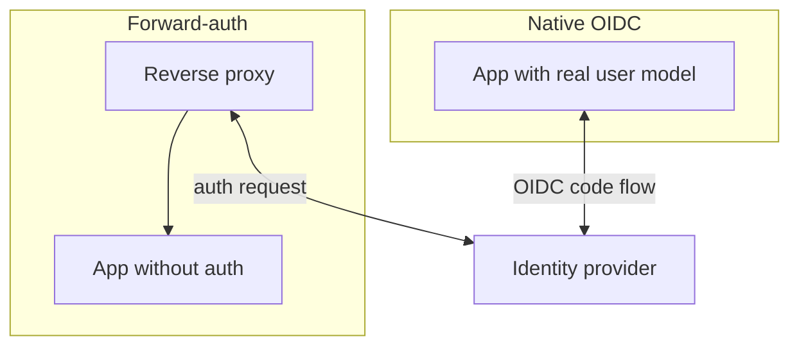
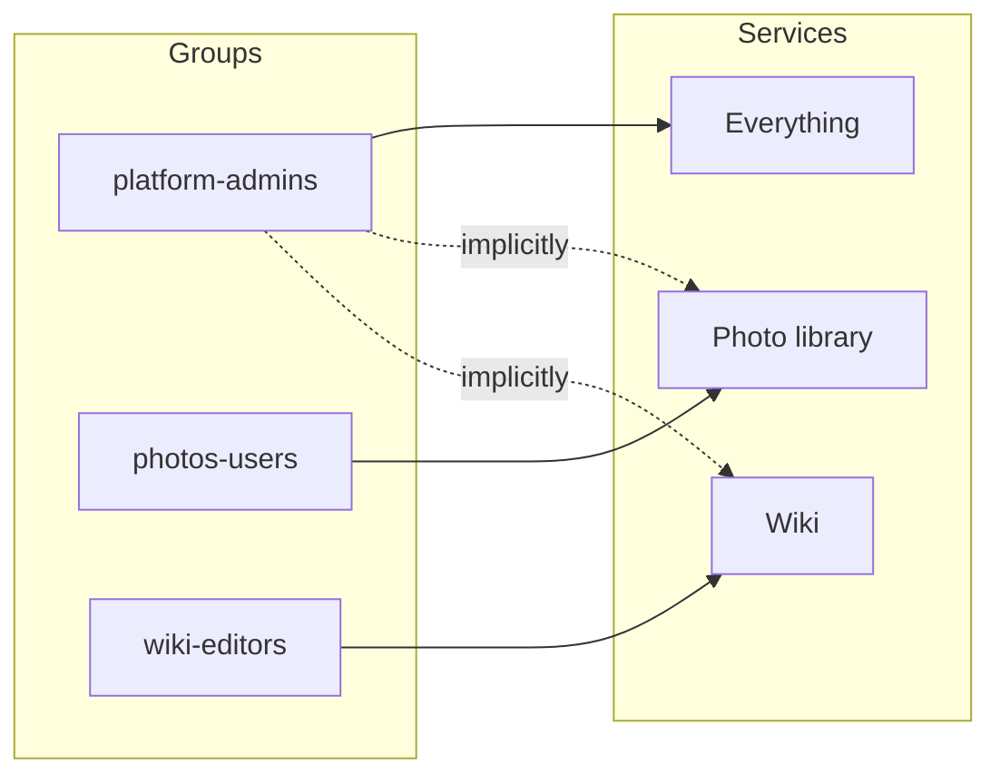

# 4 · Identity and Authorisation

## One identity provider

A single identity provider (IdP) holds every account. No service manages its own
users. This gives one place to disable an account, one place to enforce MFA, and
one audit log.

Two integration styles are used, in order of preference:

1. **Native OIDC** — the service supports OpenID Connect directly. Preferred:
   the service knows who the user is and can do its own per-user authorisation.
2. **Forward-auth** — the service has no useful auth of its own, so the reverse
   proxy calls the IdP on every request and only proxies through if the session
   is valid. The service is told the identity via trusted headers.

## MFA

Second factor (TOTP or WebAuthn) is required for every account. It is enforced at
the IdP, so it applies uniformly regardless of which service the user is heading
for.

## Authorisation

Authentication proves *who*; authorisation decides *what*. The model here is
deliberately coarse:

- **Groups, not per-user grants.** Access to a service is "member of group X",
  never a list of individual users.
- **Default deny.** A new service is bound to the operator/admin group only.
  Opening it to others is an explicit change.
- **Per-service groups for delegation.** When a specific person needs one
  specific service, they get a group scoped to that service — not membership in a
  broad "users" group.

## SSO-only

Once a service is wired to the IdP, its local login is **disabled**, not left as
a fallback. A dual login path is an unmonitored way in that bypasses MFA and the
central audit log. See ADR&nbsp;0002.

## Naming

In user-facing text the provider is referred to generically ("Sign in with
SSO"), not by product name. The implementation can change without users
relearning anything.
