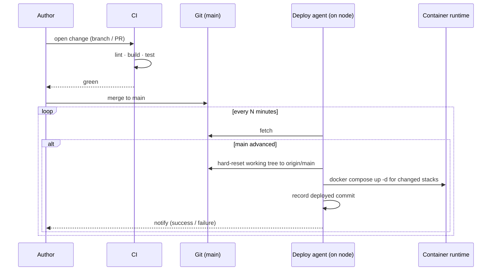

# 5 · Delivery

## GitOps, single node

The git repository is the desired state. A small deploy agent on the node
reconciles the running system to it. There is no separate "apply from my laptop"
step, and no configuration that exists only on the node.

## Rules that fall out of this

- **The node's working tree is disposable.** The agent resets it to `origin/main`
  every cycle. A change that is committed locally but not pushed will be reverted
  on the next tick — so the workflow is always commit *and* push.
- **CI gates merges, not deploys.** By the time a commit is on `main` it has
  already passed CI. The deploy agent's job is reconciliation, not validation.
- **Rollback is a revert.** To undo a deploy, revert the commit and push. The
  agent rolls the node back on the next cycle. No special tooling.
- **Drift is visible.** If someone changes something on the node by hand, the
  next reconciliation overwrites it. The repo is always right.

## CI

CI runs on a self-hosted runner and does only what is cheap and deterministic:

| Stage | What |
| --- | --- |
| Lint / format | Fast static checks; fails on any finding |
| Build | Container images build cleanly from the committed Dockerfiles |
| Test | Unit and light integration tests |
| (optional) Publish | Tag → build image → push to the local registry |

Deployment itself is **not** a CI job — it is the on-node agent. This keeps CI
credentials from ever being able to touch production directly.

## Dependency updates

An update bot opens change proposals for pinned dependencies and base images on a
schedule. Updates are held for a **minimum release age** before the bot will
propose them, so a compromised or broken release is usually caught upstream
before it is ever offered here. A human merges; nothing auto-merges to `main`.
