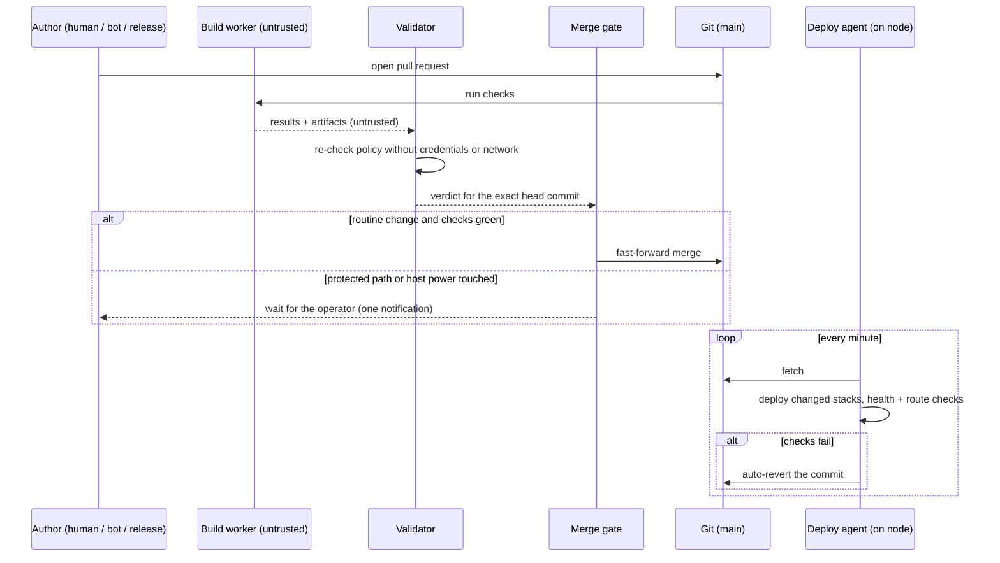
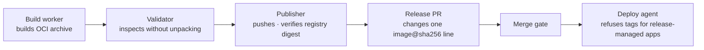

# 5 · Delivery

## GitOps, single node

The git repository is the desired state. A small deploy agent on the node
reconciles the running system to it. There is no "apply from my laptop" step,
and no configuration that exists only on the node.

`main` is **locked**: nobody pushes to it directly, the operator included.
Every change, from a person, a dependency bot or a release pipeline, arrives
as a pull request, and a **merge gate** decides whether it can merge on its own
or needs the operator. See ADR&nbsp;0008.

## The merge gate

**Routine changes merge themselves.** Image tag bumps, environment changes,
resource limits, a new plain service, the weekly dependency batch and release
digest bumps all go through once checks are green.

**Some changes always wait for the operator:**

- **Protected paths:** CI definitions, deploy and ops scripts, the secrets
  policy and encrypted files, the update-bot config, and the projects that make
  up the security boundary (proxy, identity provider, tunnel, WAF, git forge,
  VPN, DNS, IDS/HIDS, log store, the gate and validator themselves).
- **New host power:** any change that gives a service more reach into the
  host — a bind mount outside its own directory, the container socket, added
  capabilities, devices, host networking or namespaces. An unknown or
  unparseable compose key counts as host power.
- **Big dependency jumps:** major versions, and images for databases and other
  stateful cores.

The protected-path check looks at **every commit in the pull request**, not
just the final diff, so "touch a protected file, then revert it" does not slip
through. Merges are fast-forward only, against the exact commit the validator
judged.

## Four roles in CI

CI runs code from pull requests, which makes it the most exposed thing on the
node. It is split so that no single role can both run untrusted code and hold
a credential that matters:

| Role | Does | Holds |
| --- | --- | --- |
| **Build worker** | runs every CI job and builds release images | nothing worth stealing; rootless container runtime, egress firewalled; its output is treated as untrusted |
| **Validator** | re-checks policy on the worker's output | no container runtime; the check step runs with no credentials and no network, in a sandbox |
| **Merge gate** | merges, fast-forward only | merge permission, nothing else |
| **Publisher** | pushes a validated image to the registry and opens the release PR | one registry credential, issued per run |

Each role is a separate system user. The old pattern — one runner with the host
container socket — is gone, because that runner was effectively root on the
node for anyone who could open a pull request.

## Releases are pinned by digest

An app release changes exactly one line in the platform repo: that app's
`image: …@sha256:<digest>`. The deploy agent refuses a mutable tag for any
release-managed app, so what was validated is byte-for-byte what runs.

## Deploying

- **The node's working tree is disposable.** The agent resets it to
  `origin/main` every cycle, so a change made by hand on the node lasts until
  the next tick.
- **Every deploy is checked.** After bringing changed stacks up, the agent runs
  health checks and probes the public and internal routes. If they fail, it
  **reverts the commit by itself** and notifies the operator. Rollback isn't a
  procedure. It's the default.
- **No deploy without a fresh backup.** The agent refuses to deploy if the last
  full backup is older than a day.
- **CI never deploys.** Deployment is only the on-node agent. CI credentials
  cannot touch production.

## Dependency updates

An update bot proposes new versions of pinned images and dependencies on a
weekly schedule, after a **minimum release age of 7 days**. A compromised or
broken release is usually caught upstream before it is ever offered here.
Patch, minor and digest updates are batched into one pull request that the gate
merges. Majors and stateful cores wait for the operator.

Host packages are separate: security patches apply daily, a full upgrade runs
weekly, and the node reboots on a fixed weekly schedule whether or not it
"needs" to, so a reboot is never a surprise.

## Documentation is generated too

The inventory of stacks, routes, SSO bindings and how things connect is
**generated from the repository by CI**: a browsable map, an inventory page,
and a page per component with typed links (runs-on, talks-to, cert-from). CI
fails on broken links. Lists that are typed by hand go stale. Lists built from
the source of truth don't.
