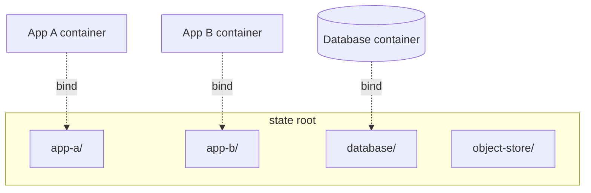
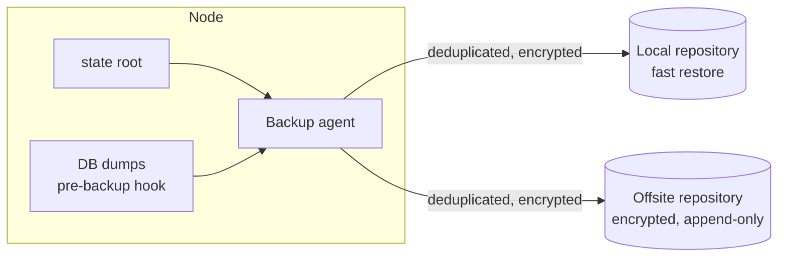

# 6 · Data and Backup

## One state root

Everything that must survive a container being rebuilt lives under a single
directory tree on the node — one subdirectory per service. Containers bind-mount
their slice of it. Nothing stateful is stored in an anonymous volume or inside
the container's writable layer.

The payoff: the backup agent has exactly one tree to think about, and "what
persists?" has one answer you can `ls`.

## Backup

- **Pull-based, or at least isolated credentials.** The backup destination is
  append-only from the node's point of view — a node compromise cannot delete or
  rewrite existing snapshots. See ADR&nbsp;0005.
- **Databases are dumped, not just file-copied.** A pre-backup hook produces a
  consistent logical dump; the dump is what gets snapshotted, alongside the
  files.
- **Two destinations.** A local repository for fast restores of "I deleted the
  wrong thing", and an offsite repository for "the node is gone".
- **Encrypted before it leaves.** The offsite location never sees plaintext.
- **Retention is tiered.** Frequent snapshots kept for days, then thinned to
  daily, weekly, monthly.

## Freshness is a deploy precondition

Backup freshness is a monitored metric, with alerts when the frequent or full
snapshot is overdue, and the deploy agent **refuses to deploy** while the
last full backup is more than a day old. A change never lands on top of
data that isn't backed up.

## Restore testing

A backup that has never been restored is a hypothesis. The levels, from
cheapest to most convincing:

1. **Repository integrity:** the backup tool verifies its own repositories on a
   schedule. *(automated)*
2. **Restore drills:** pull a snapshot into a scratch location, stand the
   service up against it, check that the data is intact. *(done by hand at
   milestones, such as after a rebuild or a backup-design change)*
3. **Scheduled restore tests:** level 2 on a timer, reporting pass/fail to
   monitoring, so a failed restore pages the operator like an outage would.
   *(the target, not yet automated)*

Being honest about which level is actually in place is part of the design. A
level-1 setup must not claim to be level 3.
