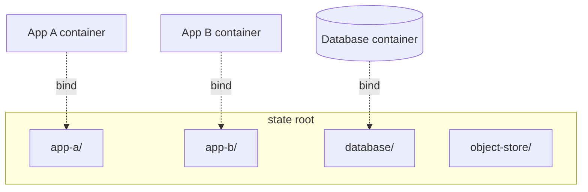
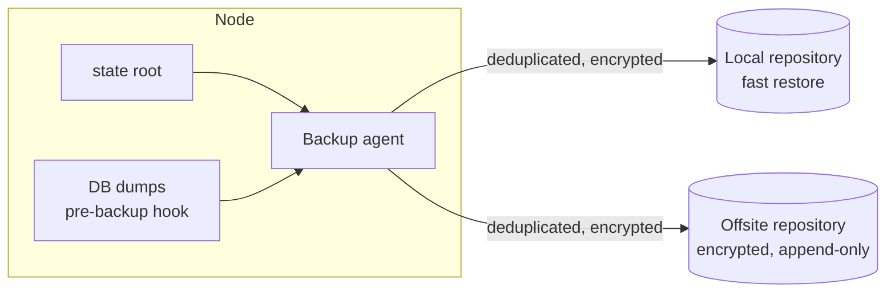

# 6 · Data and Backup

## One state root

Everything that must survive a container being rebuilt lives under a single
directory tree on the node — one subdirectory per service. Containers bind-mount
their slice of it. Nothing stateful is stored in an anonymous volume or inside
the container's writable layer.

The payoff: the backup agent has exactly one tree to think about, and "what
persists?" has one answer you can `ls`.

## Backup

- **Pull-based, or at least isolated credentials.** The backup destination is
  append-only from the node's point of view — a node compromise cannot delete or
  rewrite existing snapshots. See ADR&nbsp;0005.
- **Databases are dumped, not just file-copied.** A pre-backup hook produces a
  consistent logical dump; the dump is what gets snapshotted, alongside the
  files.
- **Two destinations.** A local repository for fast restores of "I deleted the
  wrong thing", and an offsite repository for "the node is gone".
- **Encrypted before it leaves.** The offsite location never sees plaintext.
- **Retention is tiered.** Frequent snapshots kept for days, then thinned to
  daily, weekly, monthly.

## Restore testing

A backup that has never been restored is a hypothesis. On a schedule:

1. Pull the latest snapshot into a scratch location.
2. Stand up the service against the restored data.
3. Assert it comes up healthy and the data is intact.
4. Report pass/fail to monitoring.

A failed restore test pages the operator the same as a service outage would.
