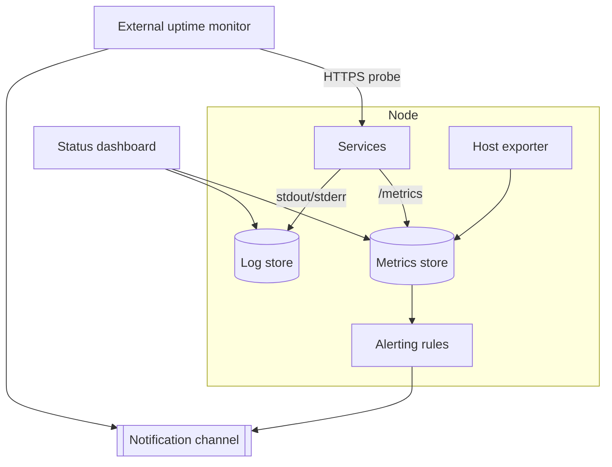

# 7 · Observability

The bar for a single-node homelab is not a full SRE stack. It is: **know before
the operator does when something is wrong, and have enough context to fix it.**

## Three questions

| Question | Answered by |
| --- | --- |
| Is it up? | External uptime check + internal health probes |
| Is it healthy? | Metrics — resource use, error rates, queue depth, cert expiry |
| What happened? | Logs — centralised, searchable, retained for a bounded window |

## Alerting

- Alerts go to a **push notification channel** the operator actually sees on
  their phone — not email that gets filtered.
- Alert on **symptoms, not causes**: "site returns 5xx", "disk will be full in
  48h", "certificate expires in 7 days", "backup job did not run", "restore test
  failed".
- Every alert names the service and links to its dashboard and logs. An alert
  with no next step is noise.
- Severity is honest: page for user-facing outage and data risk; digest
  everything else.

## Uptime

Public routes are checked **through the public path**: resolved via public DNS
and fetched through the edge provider, not over the LAN. A LAN check can pass
while the public route is broken. A truly off-node monitor that notices when
the whole node or uplink is down is the next step.

## Security detection

Detection gets the same "one job per tool" treatment as everything else:

| Layer | Job | Acts? |
| --- | --- | --- |
| Health / metrics | is it up, is it healthy, did the job run | alerts |
| Log store | everything searchable, bounded retention | no |
| Host IDS (HIDS) | file integrity, vulnerable packages, config benchmarks, auth anomalies, privileged-command audit trail | alerts |
| Network IDS | traffic signatures to and from the node | **detect only** |
| Edge IPS + WAF | internet-facing request filtering and IP reputation | **blocks** |
| Static blocklists | known-bad networks dropped at the host firewall | blocks |

Only the edge tooling and static lists block automatically. Detect-only tools
raise alerts, and a person or a triage step decides. An automatic ban based on
an IDS signature is how a homelab locks its operator out.

**Exposure is checked from the outside in**, on a schedule:

- a passive lookup of what the internet can see on the public IP, alerting on
  any open service;
- a vulnerability scan of every running image, alerting on fixable high and
  critical findings;
- expiry alerts for every certificate that matters: the CA chain, the vault
  listener, the IdP signing certificate.

**Triage can be automated, but read-only.** An automated responder may read
alerts, search logs and query monitoring through accounts that cannot change
anything. Low-severity noise expires after a couple of days. Attack-type
findings never expire without a person looking at them.

## One alert sink

Every source above, plus CI, backups and deploys, alerts into **one push
channel**. There are no side channels. A new tool that wants to alert routes
into the same sink or into the health system.

## What is deliberately not done

- No distributed tracing.
- No long-term metrics retention — weeks, not years.
- No log pipeline beyond "collect, index, expire". If a question needs more than
  that, it gets asked once, by hand.
