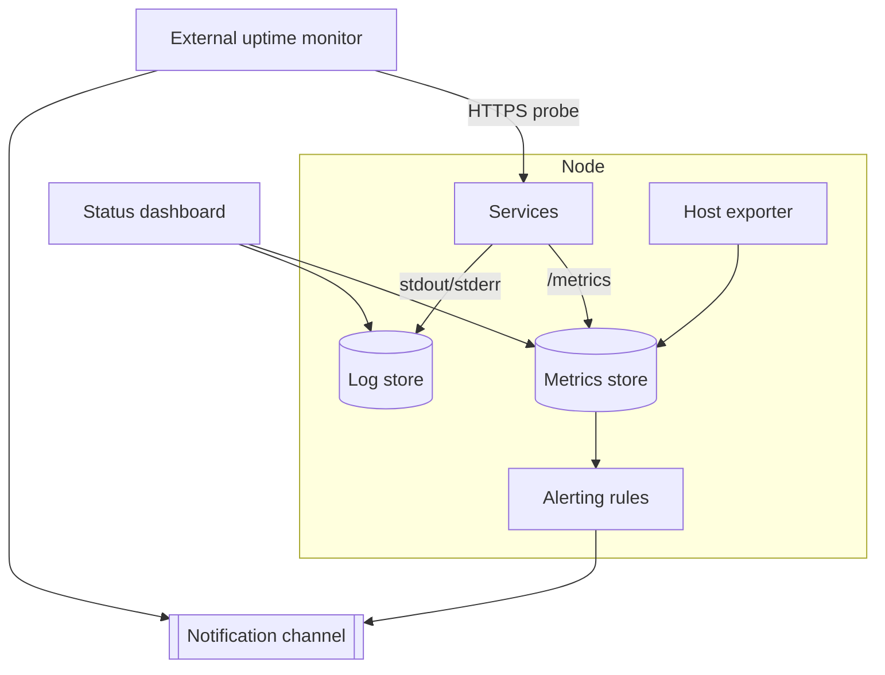

# 7 · Observability

The bar for a single-node homelab is not a full SRE stack. It is: **know before
the operator does when something is wrong, and have enough context to fix it.**

## Three questions

| Question | Answered by |
| --- | --- |
| Is it up? | External uptime check + internal health probes |
| Is it healthy? | Metrics — resource use, error rates, queue depth, cert expiry |
| What happened? | Logs — centralised, searchable, retained for a bounded window |

## Alerting

- Alerts go to a **push notification channel** the operator actually sees on
  their phone — not email that gets filtered.
- Alert on **symptoms, not causes**: "site returns 5xx", "disk will be full in
  48h", "certificate expires in 7 days", "backup job did not run", "restore test
  failed".
- Every alert names the service and links to its dashboard and logs. An alert
  with no next step is noise.
- Severity is honest: page for user-facing outage and data risk; digest
  everything else.

## Uptime

The external monitor is off-node and off-network on purpose — if the node's
internet drops, something still notices. It checks the handful of public
endpoints that matter and the VPN endpoint.

## What is deliberately not done

- No distributed tracing.
- No long-term metrics retention — weeks, not years.
- No log pipeline beyond "collect, index, expire". If a question needs more than
  that, it gets asked once, by hand.
