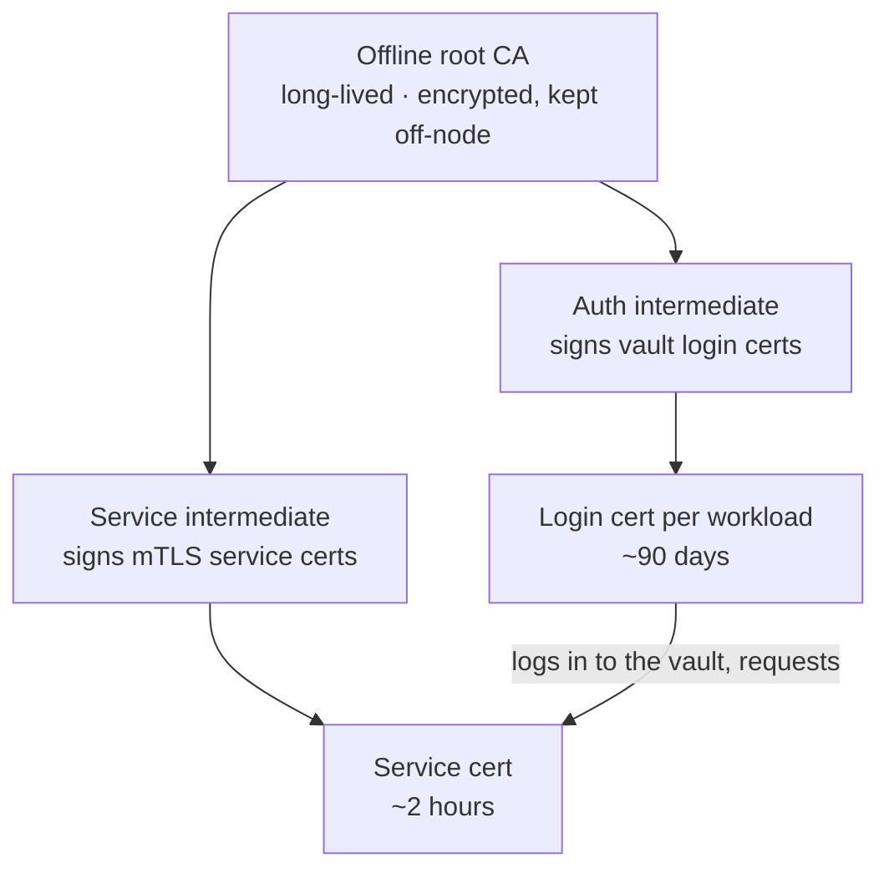

# 8 · Secrets and Workload Identity

People prove who they are to the identity provider. Machines — services,
desktop agents, scheduled jobs — need the same thing, and a shared bearer
token pasted into two config files is not an identity. This chapter covers
where secrets live and how machines authenticate to each other.

## Where secrets live

| Kind | Store | Why there |
| --- | --- | --- |
| Stack configuration secrets (DB passwords, API keys) | **encrypted in the git repo** (sops + age), rendered to env files at deploy time | the repo stays the single source of truth; diffs show *that* a secret changed, never its value |
| Machine identity (certificates) | **a private vault/CA** (OpenBao) | issuance, short lifetimes and revocation are what a vault is for |
| Human passwords | **an offline password manager** | no network service; deliberately separate from anything machines can reach |

Moving stack secrets from the repo into the vault (leased, rotated, dynamic
credentials) is the planned next stage. It only happens after the vault has
proved itself on identity alone: audit, recovery and rotation built and tested
first, then secrets. Until then, the encrypted-repo path stays the control.

## The private CA

- **The root never lives online.** It signs the intermediates and goes back
  into encrypted offline storage.
- **Two intermediates, two jobs.** One signs the long-ish *login* certificate a
  workload uses only to authenticate to the vault. The other signs the
  short-lived certificates services actually present to each other. A leaked
  service cert is useless within hours.
- **Identity is an exact name.** Each workload's certificate carries a URI
  identity (`urn:…:workload:<name>`). Every relying party checks for the
  specific identity it expects — "signed by our CA" alone is never enough.
- **Default deny in the vault.** A workload can request certificates for its
  own identity only. It cannot list, read, or widen anything else.

## Enrolment and renewal

1. A workload is added to a **declarative roster** in the repo: name, where it
   runs, what it may talk to.
2. The workload **generates its own key** and sends only a certificate signing
   request (CSR). Private keys never travel.
3. Off-node workloads (desktop, laptop) hand their CSR to an operator-run
   courier step once, and from then on renew themselves.
4. A renewer on each machine refreshes its own service certificate well
   before expiry. Each login cert can renew only itself.

## Revocation

Measured, not assumed: the reverse proxy in this design does **not** check
CRL/OCSP for client certificates. So revocation works by:

- **short lifetimes** — a service cert dies within hours on its own;
- **quarantine** — removing a workload from the roster stops its renewals
  immediately;
- **a deny list keyed on certificate serial**, checked by the receiving app,
  for the window before expiry.

## Who talks mTLS

- service ↔ service on the node (for example an orchestrator calling its
  speech and retrieval services);
- desktop and laptop agents → server APIs, through the reverse proxy's
  machine hostnames (see chapter 3);
- the proxy forwards the verified identity and serial to the app, after
  stripping any identity headers the client tried to send.

Each link was tested with no certificate, a valid certificate for the *wrong*
identity, and the right one, and the old shared tokens were then deleted.
Where a component cannot do mTLS (one game-engine client can't), it gets a
per-launch random secret on loopback instead, and that exception is written
down.

## Keeping the vault available

- **Unseal needs two factors:** a TPM on the node *and* a network key server
  elsewhere on the LAN. The node unseals itself at boot only when both are
  present. A stolen disk, or a stolen node without the LAN, stays sealed.
- **Fails closed:** if the key server is down, the vault stays sealed and the
  operator unseals by hand with split recovery keys.
- **No standing root token.** Admin access is a personal, passphrase-protected
  admin certificate. Root generation exists only as break-glass.
- **Reachability:** loopback, a private container network, and a LAN listener
  that demands a client certificate. It is never published on the tunnel.
- **Backed up** with the rest of the platform. Restoring it also needs the
  unseal material, which is stored separately.

See ADR&nbsp;0007.
